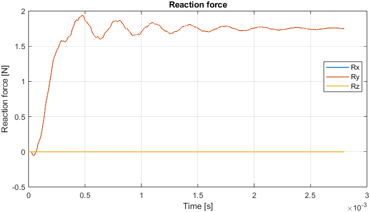
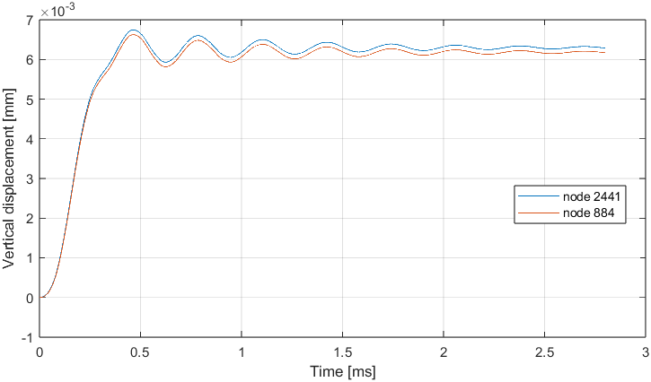
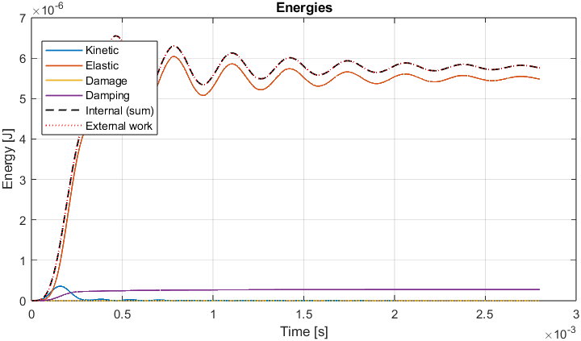
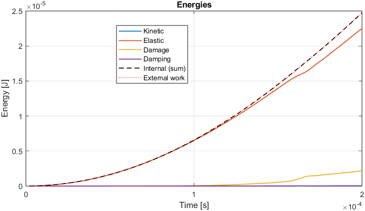

Examples
========

The folder ``examples/`` has three models that run from start to finish, each
with its inputs and a script that runs it and plots the results. The numbers in
this page come from running them with the current code.

.. list-table::
   :header-rows: 1
   :widths: 30 40 15 15

   * - Folder
     - What it shows
     - Size
     - Time
   * - ``example1_clamped_beam/``
     - A beam clamped at both ends and loaded with a force at mid-span
     - 3,086 nodes
     - about 35 s
   * - ``tension_101/``
     - A small prism under a uniaxial load, with damage and every output format
     - 74 nodes
     - about 6 s
   * - ``beam_102/``
     - The four-point bending beam of the paper (a demo of its first 50 steps)
     - 166,961 nodes
     - about 30 s for 50 steps

Start with ``tension_101`` to learn the interface and with
``example1_clamped_beam`` to see a model loaded with a force, described by a
case file and checked against the original code.

Running an example
------------------

From MATLAB, from any folder:

.. code-block:: matlab

   >> run('examples/example1_clamped_beam/runClampedBeam.m')           % script: run and plot
   >> results = ldem.run('examples/example1_clamped_beam/case.ldem');  % from the case file

The two beam examples also have a ``case.ldem``: the same model in the readable
case-file format (see :doc:`usage`), generated from the ``DATA0.DAT`` of the
original program and giving the same parameters. ``ldem.check`` shows what a
case file would simulate without running it.

The scripts write their files to a folder ``output`` next to the script (ignored
by git), or to ``outputFolder`` if that variable already exists:

* ``results.mat``: one struct, ``results``, with everything that was recorded.
  Load it with ``data = load('results.mat'); results = data.results;``.
* ``snapshot_0000.mac``, ...: ANSYS macro files of the deformed lattice.
* ``snapshot_0000.vtu``, ... and ``snapshots.pvd``: open ``snapshots.pvd`` in
  `ParaView <https://www.paraview.org/>`_ to see the damage evolve in time.

Example 1: beam clamped at both ends
------------------------------------

A small beam of 5 x 5 x 50 modules of 1 mm, clamped at both ends and loaded at
mid-span with a force that grows during 0.35 ms and then stays constant. It is
the model of Rodrigo (branch ``dev_rodrigo``) and the first test loaded with a
force instead of a displacement (``ldem.scenarios.ClampedBeam``, test 103).

The model
~~~~~~~~~

.. list-table::
   :header-rows: 1
   :widths: 25 75

   * - Part
     - Value
   * - Geometry
     - 5 x 5 x 50 modules of 1 mm (a prism of 5 x 5 x 50 mm, axis along z), with
       3,086 nodes, 18,085 bars and a mass of 1.875 g
   * - Supports
     - The centre nodes of the first and of the last layer of modules (z = 0.5 and
       z = 49.5 modules) are clamped: x, y and z held
   * - Load
     - The 5 centre nodes of the line at mid-span (z = 24.5 modules, y = 0.5 modules)
       carry a force in +y of ``1000 N/s * min(t, 0.35 ms)`` each: 0.35 N per node,
       1.75 N in total
   * - Material
     - E = 3.87 GPa, Poisson's ratio 0.25, density 1500 kg/m\ :sup:`3`, fracture
       energy 0.5 N/m, critical distance 4.5 mm; mass-proportional damping of
       2500 1/s
   * - Scatter
     - One multiplier of the critical strain per bar, read from a file (shared with
       ``beam_102``)
   * - Time
     - 2.8 ms in 8000 steps of 0.35 us (65 % of the critical step)
   * - Recorded
     - Control nodes 2441 (a loaded node) and 884 (a grid node at mid-span); tracked
       bar 14398

The original input file listed five control nodes, but nodes 6870 and 14398 do
not exist in this 3,086-node mesh, so the input keeps 2441 and 884. The tracked bar
is 14398, as in the original.

Files
~~~~~

.. list-table::
   :header-rows: 1
   :widths: 30 70

   * - File
     - Purpose
   * - ``case.ldem``
     - The model as a case file: run it with ``ldem.run``
   * - ``runClampedBeam.m``
     - Reads ``DATA0.DAT``, runs the simulation and plots the force on the clamped
       ends, the vertical displacement of the control nodes and the energies
   * - ``DATA0.DAT``
     - The parameters in the format of the original program (``TEST 103``)

The scenario and the load are the lines of the ``[scenario]`` section of
``case.ldem``:

.. code-block:: text

   [scenario]
   type          = "clamped_beam"
   force_rate    = 1000 N/s
   ramp_time     = 0.35 ms
   load_position = "midspan"
   load_height   = 0.5 modules

The same test can be written without a scenario class, with supports and loads.
It gives the same results as ``ldem.scenarios.ClampedBeam`` (the tests check it):

.. code-block:: text

   [scenario]
   type = "custom"

   [[support]]
   name     = "first end"
   z        = 0.5
   fix      = ["x", "y", "z"]
   reaction = true

   [[support]]
   name     = "last end"
   z        = "max - 0.5"
   fix      = ["x", "y", "z"]
   reaction = true

   [[load]]
   name          = "line at mid-span"
   y             = 0.5
   z             = "mid - 0.5"
   direction     = "y"
   type          = "force"
   time_function = "ramp"
   rate          = 1000 N/s
   until         = 0.35 ms

Reading the results
~~~~~~~~~~~~~~~~~~~

.. code-block:: matlab

   >> results = ldem.run('examples/example1_clamped_beam/case.ldem', OutputFolder=tempname);
   >> y0 = results.mesh.nodes0(results.params.controlNodes, 2).';
   >> dy = results.controlNodes.displacement(:, :, 2) - y0;   % vertical displacement [m]
   >> results.reactions.force(end, :)                           % force on the clamped ends [N]
   >> ldem.post.plotReaction(results);
   >> ldem.post.plotEnergy(results);

What you should see
~~~~~~~~~~~~~~~~~~~

   Force carried by the clamped ends. It rises with the load, overshoots to 1.94 N
   and settles at the total applied force.

   Vertical displacement of the two control nodes: a peak of 6.7 um at 0.46 ms and
   about 6.3 um at the end.

   Energies. The external work equals the sum of the internal energies.

* The reaction settles at 1.75 N, the 1.75 N applied in total: the beam is in
  equilibrium at the end. The overshoot (1.94 N) and the oscillation are the
  dynamic response, which the damping removes.
* With these values the beam stays elastic: at the end 18,085 bars are intact and
  none is damaged or broken.
* The energy balance closes: the external work of 5.76 uJ is the elastic energy
  (5.48 uJ) plus the energy dissipated by damping (0.28 uJ); the kinetic energy is
  about zero and the balance is below 1e-13 J.

Try other values
~~~~~~~~~~~~~~~~

Every key of the case file can be changed, or swept without editing the file
(see :doc:`usage`):

.. code-block:: matlab

   >> summary = ldem.sweep('examples/example1_clamped_beam/case.ldem', ...
          Vary = {'scenario.force_rate', ["10 kN/s" "30 kN/s" "100 kN/s"]}, Formats = "mat");

With the original value (1 kN/s) no bar is damaged. Ten times more force already
breaks the beam; each run takes about 50 s:

.. list-table::
   :header-rows: 1
   :widths: 30 40 30

   * - Force rate
     - Damaged bars (including broken)
     - Broken bars
   * - 10 kN/s
     - 5,630
     - 3,584
   * - 30 kN/s
     - 6,074
     - 3,579
   * - 100 kN/s
     - 4,760
     - 2,783

After the failure the loaded nodes keep being pushed by the force and move freely,
so the displacements of these runs are not meaningful; the damage counts are. Each run
has its own folder (``run_001``, ...) with its results and its resolved ``case.ldem``,
and the table is also saved as ``sweep_summary.csv``.

Other changes to try in ``case.ldem``: ``law = "linear_elastic"`` (no damage at all),
``type = "generated"`` with a ``cv`` in ``[material.scatter]`` to generate the random
field in memory instead of reading it, or ``type = "none"`` to remove the scatter.

Example: uniaxial prism
-----------------------

``examples/tension_101/runTension.m`` runs a prism of 5 x 2 x 2 modules of 3 mm
(74 nodes, 313 bars) under the uniaxial test (test 101): the centre nodes of the
last column move along x with a prescribed velocity of 4 mm/s while those of the
first column are held. It is the best place to start: it has no input file, the
model is described in the script with ``ldem.Parameters``, and it writes every kind
of output.

.. list-table::
   :header-rows: 1
   :widths: 25 75

   * - Part
     - Value
   * - Material
     - E = 32 GPa, Poisson's ratio 0.25, density 2000 kg/m\ :sup:`3`; a low fracture
       energy of 0.1 N/m on purpose, so that bars soften and break
   * - Time
     - 0.2 ms in 1000 steps of 0.2 us
   * - Output
     - Snapshots (ANSYS and VTK) every 250 steps, control nodes and energies every 10
       steps, no tracked bar

At the end 251 bars are intact, 58 are damaged and 4 are broken. The external work
is 24.7 uJ: 22.5 uJ of elastic energy, 2.2 uJ dissipated by damage and 0.03 uJ by
damping; the balance is 0.01 % of the external work.

   Energies of the uniaxial prism.

With the sign convention of the original code a positive ``loadingVelocity`` moves
the loaded face toward the fixed one, that is, it compresses the prism; use a
negative value to pull it (see ``ldem.scenarios.UniaxialTension``).

Example: four-point bending beam
--------------------------------

``examples/beam_102/runBeam.m`` reads the input of the beam of the paper (test 102,
``ldem.scenarios.FourPointBending``): 100 x 40 x 20 modules of 3 mm (300 x 120 x 60
mm), 166,961 nodes and 1,126,960 bars. The beam rests on two supports 4.5 modules
from its ends and two load points 33.5 modules from its ends push its top face down
with a prescribed velocity of 4 mm/s. The material is E = 32 GPa, density 2000
kg/m\ :sup:`3`, fracture energy 50 N/m, critical distance 28 mm, with a random field
of the critical strain read from a file.

The real simulation has 150,000 steps (0.03 s in steps of 0.2 us) and needs roughly
20 hours on a laptop (about 0.5 s per step). The script therefore runs only the first
50 steps: it builds the complete model (about 20 s) and shows that the input is read
and the model runs; the plotted reaction is only that of the start of the test. Change
``nStepsDemo`` at the top of the script, or remove the ``totalTime`` override, for
the full run.

.. list-table::
   :header-rows: 1
   :widths: 35 65

   * - File
     - Purpose
   * - ``case.ldem``
     - The same parameters as a case file (``ldem.io.readCase``, ``ldem.run``)
   * - ``DATA0.DAT``
     - Parameters in the format of the original program (``ldem.Parameters.fromFile``)
   * - ``arquivo_3lc_rnao_cv05``
     - Random field applied to the critical strain of each bar (11 MB); it is also used
       by ``example1_clamped_beam``
   * - ``runBeam.m``
     - Reads the input, runs the first 50 steps and plots the reaction force
