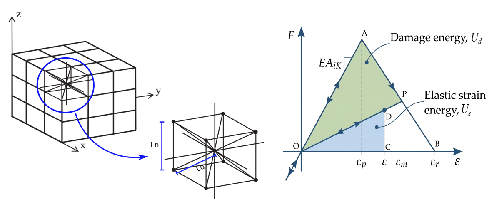
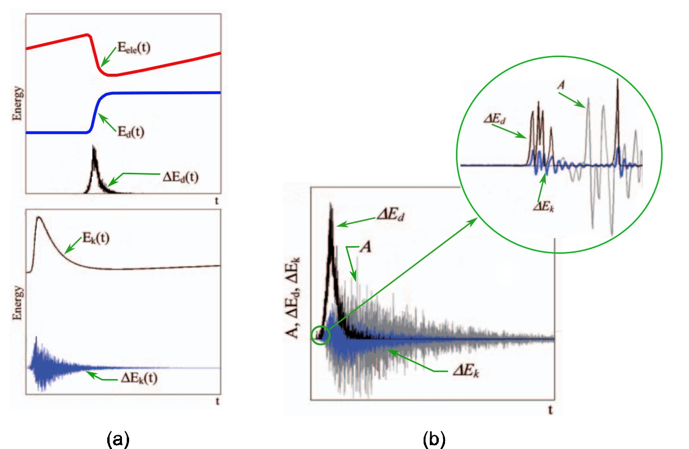

Introduction
============

The **Lattice Discrete Element Method (LDEM)**, also called the *truss-like
discrete element method*, was proposed by Riera [Riera1984]_ to study impact
on concrete structures. It represents a solid not as a mesh of finite elements
but as a periodic three-dimensional lattice of bars that carry only axial force,
with the mass of the material lumped at the nodes. Because fracture is modelled
simply by breaking bars, the method follows the initiation, propagation and
interaction of cracks without remeshing and without any criterion to decide
where a crack goes.

This page summarises the theory implemented in this program: the lattice, its
equivalence with an elastic continuum, the equations of motion, the constitutive
law of the bars, the random field of material properties and the energy balance.
The last sections relate each concept to the ``ldem`` package and list the
references.

LDEM among the discrete methods
-------------------------------

Discrete methods describe a body as a set of interacting entities instead of a
continuous field. The best known is the particle discrete element method of
Cundall and Strack [CundallStrack1979]_, in which rigid particles interact
through contact laws; it is the standard tool for granular materials
[OSullivan2011]_. *Lattice* models instead connect the nodes of a fixed
network with one-dimensional elements (springs, bars or beams) and are widely
used for the meso-scale fracture of quasi-brittle solids [JivkovYates2012]_
[MastilovicRinaldi2015]_. Non-local continuum formulations such as
peridynamics [Silling2000]_ [SillingAskari2005]_ pursue the same goal, cracks
as a natural outcome of the model, from a different starting point. A review of
these approaches for rock fracture is given by Jenabidehkordi
[Jenabidehkordi2019]_.

LDEM belongs to the lattice family. Its distinctive features are a regular
cubic arrangement of bars whose stiffness is calibrated to reproduce an elastic
continuum exactly, a bilinear softening law whose dissipated energy is tied to
the fracture energy of the material, and an explicit time integration that makes
it naturally suited to dynamic problems.

The basic cubic module
----------------------

The lattice comes from the work of Nayfeh and Hefzy [NayfehHefzy1978]_, who
showed that a regular truss built by repeating a cubic cell can represent an
orthotropic elastic material. Riera [Riera1984]_ adopted that arrangement to
solve problems of structural dynamics.

Each cubic module of side :math:`L_n` has **nine nodes**, the eight corners and
the centre, and **twenty bars**: twelve *longitudinal* (normal) bars along the
edges and eight *diagonal* bars that join the centre node to the corners
(:numref:`fig-ldem-module`\ a). When modules are assembled, further longitudinal
bars join the centre nodes of adjacent modules, so the lattice is made of two
interpenetrating cubic grids connected by the diagonals. The diagonal bars have
length

.. math::
   :label: eq-diagonal-length

   L_d = \frac{\sqrt{3}}{2}\, L_n .

Every node has three translational degrees of freedom,
:math:`\mathbf{u} \in \mathbb{R}^3`; there are no rotations. The mass of each
module, :math:`\rho L_n^3`, is lumped at the nodes: half at the centre node and
the other half shared among the eight corners. Nodes on the surface of the
prism belong to fewer modules and receive a correspondingly smaller mass.

.. _fig-ldem-module:

   Essential components of the LDEM model: (a) the basic cubic module inside a
   LDEM lattice, with the longitudinal bar length :math:`L_n` and the diagonal
   bar length :math:`L_d`; (b) the bilinear constitutive law of the bars, with
   the damage energy :math:`U_d` and the recoverable elastic energy
   :math:`U_s`.

Equivalence with an elastic continuum
-------------------------------------

The axial stiffnesses of the longitudinal (:math:`EA_n`) and diagonal
(:math:`EA_d`) bars are chosen so that the lattice and an isotropic elastic
solid of Young's modulus :math:`E` and Poisson's ratio :math:`\nu` store the
same strain energy under any homogeneous deformation:

.. math::
   :label: eq-bar-stiffness

   EA_n = \varphi\, E\, L_n^2, \qquad
   EA_d = \frac{2}{\sqrt{3}}\, \delta\, EA_n ,

where the dimensionless coefficients

.. math::
   :label: eq-lattice-coefficients

   \delta = \frac{9\nu}{4 - 8\nu}, \qquad
   \varphi = \frac{9 + 8\delta}{18 + 24\delta}

link the parameters of the bars to those of the continuum. Poisson's ratio
enters through :math:`\delta`. For :math:`\nu = 0.25` (:math:`\delta = 1.125`,
:math:`\varphi = 0.4`) the lattice is exactly equivalent to an isotropic
elastic solid; for other values the equivalence is exact for normal strains and
approximate for shear terms. The relation between the stiffness of the bars and
the properties of the solid, including the effect of the size of the module,
was studied in detail by Kosteski et al. [Kosteski2012]_.

Equations of motion and time integration
----------------------------------------

The spatial discretisation leads to a system of equations of motion of the
standard form

.. math::
   :label: eq-motion

   \mathbf{M}\,\ddot{\mathbf{u}} + \mathbf{C}\,\dot{\mathbf{u}}
   + \mathbf{F}_r(t) - \mathbf{P}(t) = \mathbf{0},

where :math:`\mathbf{u}` is the vector of nodal displacements and the dots
denote time derivatives, :math:`\mathbf{M}` is the mass matrix and
:math:`\mathbf{C}` the damping matrix, :math:`\mathbf{F}_r(t)` is the vector of
internal forces exerted by the bars on the nodes and :math:`\mathbf{P}(t)` the
vector of external forces. No stiffness matrix is ever assembled: at every time
step the internal forces are computed bar by bar from the current positions of
the nodes.

Damping is an internal viscous damping proportional to the nodal velocities and
to the mass, :math:`\mathbf{C} = D_f\,\mathbf{M}`, with

.. math::
   :label: eq-damping

   D_f \simeq 2\pi f_m\, \xi_m ,

where :math:`f_m` is the dominant (barycentric) frequency of the energy
spectrum of the response and :math:`\xi_m` the corresponding damping ratio.
Since :math:`\mathbf{M}` is diagonal and :math:`\mathbf{C}` is proportional to
it, the system :eq:`eq-motion` is **uncoupled**: each degree of freedom is
advanced independently.

The equations are integrated with the explicit **central difference** scheme.
Replacing the velocity and the acceleration at time :math:`t_n` by

.. math::
   :label: eq-central-difference

   \dot{\mathbf{u}}_n = \frac{\mathbf{u}_{n+1} - \mathbf{u}_{n-1}}{2\,\Delta t},
   \qquad
   \ddot{\mathbf{u}}_n = \frac{\mathbf{u}_{n+1} - 2\,\mathbf{u}_n + \mathbf{u}_{n-1}}{\Delta t^2}

gives the displacements :math:`\mathbf{u}_{n+1}` of every node directly from
the two previous steps, with no system of equations to solve. Because the nodal
coordinates are updated at every step, large displacements and rotations are
accounted for naturally. The scheme is conditionally stable: the time step must
be smaller than the time a longitudinal wave takes to cross the shortest bar,

.. math::
   :label: eq-critical-time-step

   \Delta t \le \Delta t_{cr} = \frac{L_d}{c_p}, \qquad c_p = \sqrt{E/\rho}.

Constitutive law and fracture
-----------------------------

The response of every bar, longitudinal or diagonal, follows the bilinear
force-strain law of :numref:`fig-ldem-module`\ b, which goes back to the
cohesive crack model of Hillerborg et al. [Hillerborg1976]_
[Hillerborg1978]_. It relates the axial force of the bar to its axial strain
and captures the loss of load-carrying capacity that represents the
irreversible effects of damage, such as the nucleation and growth of cracks.

The bar is linear elastic up to the critical strain :math:`\varepsilon_p`,
where it reaches its maximum force (point A). Beyond that point it softens
linearly until the rupture strain :math:`\varepsilon_r` (point B), where the
force vanishes and the bar breaks for good. Unloading from a point P on the
softening branch returns to the origin with a reduced (secant) stiffness. The
area of triangle OAB is the energy needed to break the bar; at point P, the area
of triangle OAP is the energy already dissipated by damage (:math:`U_d`) and
the area of triangle OPC is the recoverable elastic energy (:math:`U_s`). In
compression quasi-brittle materials such as concrete or rock are assumed to
remain linear elastic, so failure under compressive loads occurs indirectly,
through tensile cracking of the bars transverse to the load. The law can be
replaced by other forms when a material requires it.

The critical strain follows from the specific fracture energy :math:`G_f` of
the material:

.. math::
   :label: eq-critical-strain

   \varepsilon_p = \sqrt{\frac{G_f}{E\, d_{eq}}} ,

where :math:`d_{eq}` is a characteristic length of the material. Writing the
tensile strength as :math:`f_t = E\,\varepsilon_p` shows that
:math:`d_{eq} = E\,G_f / f_t^2`, Hillerborg's characteristic length. Its
physical meaning is the size of crack that can propagate unstably once a
certain stress is reached: if a structure is smaller than :math:`d_{eq}`, its
cracks never propagate unstably. Iturrioz et al. [Iturrioz2014]_ discuss this
point in depth.

The rupture strain is fixed by requiring that breaking a bar dissipates the same
energy as fracturing its share of the continuum, :math:`G_f A_i^*`, where
:math:`A_i^*` is the *equivalent fracture area* of the bar. Equating
:math:`G_f A_i^*` to the area OAB, :math:`\tfrac{1}{2}\,E A_i\,\varepsilon_p\,\varepsilon_r\,L_i`,
gives

.. math::
   :label: eq-rupture-strain

   \varepsilon_r = K_r\, \varepsilon_p, \qquad
   K_r = \frac{2\, d_{eq}}{L_i}\, \frac{A_i^*}{A_i},

where the subscript :math:`i` stands for the type of bar (:math:`n` for
longitudinal, :math:`d` for diagonal), :math:`L_i` is its length and
:math:`A_i` its cross-section (:math:`A_n = \varphi L_n^2`). The equivalent
fracture area is found by equating the energy dissipated by a crack that splits
a cubic cell of the continuum along a plane parallel to a face with the energy
dissipated by the bars it breaks [Kosteski2012]_ [Kosteski2020]_; the result is
:math:`A_i^* = c_A\, L_i^2` with :math:`c_A \approx 0.1385`. Substituting
these expressions,

.. math::
   :label: eq-critical-length

   K_r = \frac{L_{cr}}{L_i}, \qquad L_{cr} = \frac{2\, c_A\, d_{eq}}{\varphi} .

For the softening branch to exist, and for the bar to be stable, the rupture
strain must exceed the critical strain, :math:`K_r > 1`. In other words, the
bars must be shorter than the critical length :math:`L_{cr}`, which limits the
module size that can be used for a given material: for :math:`\nu = 0.25`,
:math:`L_{cr} \approx 0.69\, d_{eq}`.

Heterogeneity: a random field of material properties
----------------------------------------------------

Real quasi-brittle materials are heterogeneous, and that heterogeneity controls
where damage starts and how it localises. LDEM represents it by treating a
material property, typically the fracture energy :math:`G_f`, as a random field
with a Weibull distribution,

.. math::
   :label: eq-weibull

   F(G_f) = 1 - \exp\left[-\left(\frac{G_f}{\beta}\right)^{\gamma}\right],

where :math:`\beta` and :math:`\gamma` are the scale and shape parameters. They
are obtained from the mean :math:`\mu` and the coefficient of variation
:math:`CV` of the property:

.. math::
   :label: eq-weibull-moments

   \mu = \beta\, \Gamma\!\left(1 + \tfrac{1}{\gamma}\right), \qquad
   CV^2 = \frac{\Gamma\left(1 + \tfrac{2}{\gamma}\right)}
               {\Gamma^2\left(1 + \tfrac{1}{\gamma}\right)} - 1 .

The values are spatially correlated over a correlation length, so that
neighbouring bars have similar properties. Puglia et al. [Puglia2019]_ describe
how the spatial structure of the field is generated and how it affects the
results.

Energy balance and acoustic emission
------------------------------------

At every time step the program evaluates the terms of the energy balance

.. math::
   :label: eq-energy-balance

   E_{ext}(t) = E_k(t) + E_{el}(t) + E_d(t) + E_{damp}(t),

where :math:`E_{ext}` is the work of the external forces and prescribed
displacements, :math:`E_k` the kinetic energy, :math:`E_{el}` the elastic
energy stored in the bars, :math:`E_d` the energy dissipated by damage and
:math:`E_{damp}` the energy dissipated by damping. The balance is a check on the
quality of the integration, and its terms are a direct window on the fracture
process.

When a bar breaks, part of the elastic energy it stored is dissipated and part
is released as kinetic energy, which travels through the lattice as stress
waves. This is the mechanism behind **acoustic emission (AE)**: the energy
released by fracture, :math:`E_s`, is linked to the drop of potential energy
during damage, and the amplitude :math:`A` of the AE signal is related to it
[ChakrabartiBenguigui1997]_ [Carpinteri1995]_. To capture the released energy
in the simulation, the increments of kinetic and dissipated energy between two
consecutive integration times are computed,

.. math::
   :label: eq-energy-increments

   \Delta E_k(t_i) = E_k(t_i) - E_k(t_{i-1}), \qquad
   \Delta E_d(t_i) = E_d(t_i) - E_d(t_{i-1}).

:numref:`fig-ldem-energy`\ a shows how the elastic, dissipated and kinetic
energies change around a typical damage event, together with
:math:`\Delta E_d` and :math:`\Delta E_k`. :numref:`fig-ldem-energy`\ b
superposes those increments with a measured AE signal. The signal starts slightly
later than the energy increments: the energy terms are computed at the instant
the fracture happens, while the elastic waves it emits need some time to reach
the sensor.

The AE energy measured in the laboratory is usually the integral of the
captured signal. The variation of the kinetic energy during the simulation,
proportional to :math:`\mathrm{d}E_k/\mathrm{d}t`, has the same signature as
the measured signal amplitude. This makes it possible to simulate AE with LDEM
and to use the simulations to interpret AE tests [Iturrioz2013]_
[Iturrioz2014]_ [RojoTanzi2023b]_.

.. _fig-ldem-energy:

   Energy balance and acoustic emission, modified from Iturrioz et al.
   [Iturrioz2013]_. (a) Evolution of the elastic (:math:`E_{el}`), dissipated
   (:math:`E_d`) and kinetic (:math:`E_k`) energies during a typical event,
   with the increments :math:`\Delta E_d` and :math:`\Delta E_k`. (b)
   Superposition of :math:`\Delta E_k`, :math:`\Delta E_d` and the AE signal
   amplitude :math:`A`; the zoom on the start of the event shows the delay of
   the signal with respect to the energy increments.

Applications
------------

LDEM is particularly suited to quasi-brittle materials under static, dynamic or
impact loading. It has been applied to:

* reinforced concrete plates and shells under impact and impulsive loads
  [RieraIturrioz1998]_ [Kosteski2015]_;
* crack propagation in elastic solids [Kosteski2012]_;
* the generation and propagation of earthquakes [Dalguer2003]_ [Birck2018]_ and
  wave propagation in heterogeneous geological media [IturriozRiera2021]_;
* the simulation of acoustic emission and the interpretation of AE tests on
  concrete and rock [Iturrioz2013]_ [Iturrioz2014]_ [Birck2018]_
  [RojoTanzi2023b]_;
* damage processes in quasi-brittle materials [RojoTanzi2023a]_;
* size and scale effects, including their fractal nature [Kosteski2020]_
  [Kosteski2022]_ [Kosteski2024]_.

To reduce the computational cost of large models, LDEM has also been coupled
with the finite element method: the region where fracture is expected is
modelled with LDEM and the rest of the domain with ordinary finite elements.

Main assumptions and limits
---------------------------

* Bars carry only axial force and nodes have no rotations; bending and torsion
  of the material emerge from the lattice as a whole.
* The elastic equivalence is exact for :math:`\nu = 0.25`; for other values of
  Poisson's ratio it is approximate.
* The bars must be shorter than the critical length :math:`L_{cr}`
  (:eq:`eq-critical-length`), which ties the module size to the material through
  :math:`d_{eq}`.
* The explicit integration is stable only below :math:`\Delta t_{cr}`
  (:eq:`eq-critical-time-step`). Static or slow tests are run as dynamic ones
  with a loading rate low enough, and enough damping, for inertial effects to be
  negligible.

From the theory to the code
---------------------------

The table relates each concept above to the part of the ``ldem`` package that
implements it and to the parameter that controls it (see :doc:`api/index` and
the case file keys in :doc:`usage`).

.. list-table::
   :header-rows: 1
   :widths: 30 38 32

   * - Concept
     - Implemented in
     - Parameters
   * - Cubic modules, nodes and bars
     - ``ldem.mesh.buildMesh``
     - ``moduleLength`` (:math:`L_n`), ``nModules``
   * - Lumped nodal masses
     - ``ldem.mesh.computeNodalMasses``
     - ``density`` (:math:`\rho`)
   * - Coefficients :math:`\delta`, :math:`\varphi` :eq:`eq-lattice-coefficients`
     - ``ldem.material.latticeCoefficients``
     - ``poissonRatio`` (:math:`\nu`)
   * - Bar stiffness :eq:`eq-bar-stiffness`
     - ``ldem.material.computeBarStiffness``
     - ``youngModulus`` (:math:`E`)
   * - Critical strain and :math:`K_r` :eq:`eq-critical-strain`–:eq:`eq-critical-length`
     - ``ldem.material.buildBarProperties``
     - ``fractureEnergy`` (:math:`G_f`), ``criticalDistance`` (:math:`d_{eq}`),
       ``failureAreaFactor`` (:math:`c_A`)
   * - Bilinear law
     - ``ldem.material.bilinearLaw``
     -
   * - Weibull random field :eq:`eq-weibull`
     - ``ldem.material.generateRandomField``
     - ``randomFieldCv``, ``randomFieldCorrelationLength``, ``randomFieldSeed``,
       ``randomFieldFile``
   * - Damping :eq:`eq-damping`
     - ``ldem.solver.dampingCoefficient``
     - ``dampingInitial``, ``dampingFinal`` (:math:`D_f`)
   * - Central differences :eq:`eq-central-difference`
     - ``ldem.solver.integrateStep``
     - ``dt`` (:math:`\Delta t`)
   * - Critical time step :eq:`eq-critical-time-step`
     - ``ldem.Parameters`` (``criticalTimeStep``)
     -
   * - Energy balance :eq:`eq-energy-balance`
     - ``ldem.solver.computeEnergies``
     -

Two details of the implementation are worth knowing:

* :math:`K_r` is evaluated for every bar with its own length, so the diagonals,
  being shorter, have a larger :math:`K_r` than the longitudinal bars. The
  program stops with the error ``ldem:material:criticalLengthTooShort`` if any
  bar has :math:`K_r < 1.01`.
* The random field is applied as a multiplier of the critical strain
  :math:`\varepsilon_p` of each bar, with mean 1 and the coefficient of
  variation ``randomFieldCv``. Weibull values are drawn on a grid of poles
  spaced ``randomFieldCorrelationLength`` modules apart and interpolated to the
  bars.

The ``ldem`` package
--------------------

Main parts of the package (see :doc:`api/index`):

* ``ldem.Parameters`` / ``ldem.io.readCase`` – validated input data, from MATLAB
  code or from a case file.
* ``ldem.run`` / ``ldem.sweep`` / ``ldem.check`` – run, sweep and check a case file.
* ``ldem.mesh`` – nodes, bars, masses and bar geometry.
* ``ldem.material`` – bar stiffness, critical strain and the bilinear damage law.
* ``ldem.scenarios`` – supports, loads and reactions of each test.
* ``ldem.solver`` – time integration and energy balance.
* ``ldem.runSimulation`` – the whole simulation, with ``results.mat``, ANSYS and
  VTK output.

The routines of the original program (``ini_DEM3``, ``read_dat0``, ``RMEC``,
``BOUND``, ``CALOAD``, ``ENERG2``, ...) are kept in the git history under the tag
``legacy-reference``; the ``Legacy:`` line of each help text names the routine it
replaces.

References
----------

.. [Birck2018] Birck, G., Riera, J. D., & Iturrioz, I. (2018). Numerical DEM
   simulation of AE in plate fracture and analogy with the frequency of seismic
   events in SCRs. *Engineering Failure Analysis*, 93, 214–223.
   https://doi.org/10.1016/j.engfailanal.2018.06.024

.. [Carpinteri1995] Carpinteri, A., Chiaia, B., & Ferro, G. (1995).
   Multifractal nature of material microstructure and size effects on nominal
   tensile strength. In *Fracture of Brittle Disordered Materials: Concrete,
   Rock and Ceramics* (pp. 21–50). E & FN Spon.

.. [ChakrabartiBenguigui1997] Chakrabarti, B. K., & Benguigui, L. G. (1997).
   *Statistical Physics of Fracture and Breakdown in Disordered Systems*.
   Oxford University Press.

.. [CundallStrack1979] Cundall, P. A., & Strack, O. D. L. (1979). A discrete
   numerical model for granular assemblies. *Géotechnique*, 29(1), 47–65.
   https://doi.org/10.1680/geot.1979.29.1.47

.. [Dalguer2003] Dalguer, L. A., Irikura, K., & Riera, J. D. (2003).
   Simulation of tensile crack generation by three-dimensional dynamic shear
   rupture propagation during an earthquake. *Journal of Geophysical Research:
   Solid Earth*, 108(B3). https://doi.org/10.1029/2001JB001738

.. [Hillerborg1976] Hillerborg, A., Modéer, M., & Petersson, P.-E. (1976).
   Analysis of crack formation and crack growth in concrete by means of fracture
   mechanics and finite elements. *Cement and Concrete Research*, 6(6),
   773–781. https://doi.org/10.1016/0008-8846(76)90007-7

.. [Hillerborg1978] Hillerborg, A. (1978). *A model for fracture analysis*
   (Report TVBM-3005). Division of Building Materials, Lund Institute of
   Technology, Lund University.

.. [Iturrioz2013] Iturrioz, I., Lacidogna, G., & Carpinteri, A. (2013).
   Experimental analysis and truss-like discrete element model simulation of
   concrete specimens under uniaxial compression. *Engineering Fracture
   Mechanics*, 110, 81–98. https://doi.org/10.1016/j.engfracmech.2013.07.011

.. [Iturrioz2014] Iturrioz, I., Lacidogna, G., & Carpinteri, A. (2014).
   Acoustic emission detection in concrete specimens: experimental analysis and
   lattice model simulations. *International Journal of Damage Mechanics*,
   23(3), 327–358. https://doi.org/10.1177/1056789513494232

.. [IturriozRiera2021] Iturrioz, I., & Riera, J. D. (2021). Assessment of the
   lattice discrete element method in the simulation of wave propagation in
   inhomogeneous linearly elastic geologic materials. *Soil Dynamics and
   Earthquake Engineering*, 151, 106952.
   https://doi.org/10.1016/j.soildyn.2021.106952

.. [Jenabidehkordi2019] Jenabidehkordi, A. (2019). Computational methods for
   fracture in rock: a review and recent advances. *Frontiers of Structural and
   Civil Engineering*, 13(2), 273–287.
   https://doi.org/10.1007/s11709-018-0459-5

.. [JivkovYates2012] Jivkov, A. P., & Yates, J. R. (2012). Elastic behaviour of
   a regular lattice for meso-scale modelling of solids. *International Journal
   of Solids and Structures*, 49(22), 3089–3099.
   https://doi.org/10.1016/j.ijsolstr.2012.06.010

.. [Kosteski2012] Kosteski, L., Barrios D'Ambra, R., & Iturrioz, I. (2012).
   Crack propagation in elastic solids using the truss-like discrete element
   method. *International Journal of Fracture*, 174(2), 139–161.
   https://doi.org/10.1007/s10704-012-9684-4

.. [Kosteski2015] Kosteski, L. E., Riera, J. D., Iturrioz, I., Singh, R. K., &
   Kant, T. (2015). Analysis of reinforced concrete plates subjected to impact
   employing the truss-like discrete element method. *Fatigue & Fracture of
   Engineering Materials & Structures*, 38(3), 276–289.
   https://doi.org/10.1111/ffe.12227

.. [Kosteski2020] Kosteski, L. E., Iturrioz, I., Lacidogna, G., & Carpinteri, A.
   (2020). Size effect in heterogeneous materials analyzed through a lattice
   discrete element method approach. *Engineering Fracture Mechanics*, 232,
   107041. https://doi.org/10.1016/j.engfracmech.2020.107041

.. [Kosteski2022] Kosteski, L. E., Iturrioz, I., Friedrich, L. F., &
   Lacidogna, G. (2022). A study by the lattice discrete element method for
   exploring the fractal nature of scale effects. *Scientific Reports*, 12,
   16759. https://doi.org/10.1038/s41598-022-20137-3

.. [Kosteski2024] Kosteski, L. E., Friedrich, L. F., Costa, M. M., Bremm, C.,
   Iturrioz, I., Xu, J., & Lacidogna, G. (2024). Fractal scale effect in
   quasi-brittle materials using a version of the discrete element method.
   *Fractal and Fractional*, 8(12), 678.
   https://doi.org/10.3390/fractalfract8120678

.. [MastilovicRinaldi2015] Mastilovic, S., & Rinaldi, A. (2015).
   Two-dimensional discrete damage models: discrete element methods, particle
   models, and fractal theories. In *Handbook of Damage Mechanics*
   (pp. 273–303). Springer.

.. [NayfehHefzy1978] Nayfeh, A. H., & Hefzy, M. S. (1978). Continuum modeling
   of three-dimensional truss-like space structures. *AIAA Journal*, 16(8),
   779–787. https://doi.org/10.2514/3.7581

.. [OSullivan2011] O'Sullivan, C. (2011). *Particulate Discrete Element
   Modelling: A Geomechanics Perspective*. CRC Press.
   https://doi.org/10.1201/9781482266498

.. [Puglia2019] Puglia, V. B., Kosteski, L. E., Riera, J. D., & Iturrioz, I.
   (2019). Random field generation of the material properties in the lattice
   discrete element method. *The Journal of Strain Analysis for Engineering
   Design*, 54(4), 236–246. https://doi.org/10.1177/0309324719858849

.. [Riera1984] Riera, J. D. (1984). Local effects in impact problems on
   concrete structures. In *Proceedings of the Conference on Structural
   Analysis and Design of Nuclear Power Plants*, Vol. 3. Porto Alegre, Brazil.

.. [RieraIturrioz1998] Riera, J. D., & Iturrioz, I. (1998). Discrete elements
   model for evaluating impact and impulsive response of reinforced concrete
   plates and shells subjected to impulsive loading. *Nuclear Engineering and
   Design*, 179(2), 135–144. https://doi.org/10.1016/S0029-5493(97)00270-7

.. [RojoTanzi2023a] Rojo Tanzi, B. N., Birck, G., Sobczyk, M., Iturrioz, I., &
   Lacidogna, G. (2023). Truss-like discrete element method applied to damage
   process simulation in quasi-brittle materials. *Applied Sciences*, 13(8),
   5119. https://doi.org/10.3390/app13085119

.. [RojoTanzi2023b] Rojo Tanzi, B. N., Sobczyk, M., Iturrioz, I., &
   Lacidogna, G. (2023). Damage evolution in quasi-brittle materials:
   experimental analysis by AE and numerical simulation. *Applied Sciences*,
   13(19), 10947. https://doi.org/10.3390/app131910947

.. [Silling2000] Silling, S. A. (2000). Reformulation of elasticity theory for
   discontinuities and long-range forces. *Journal of the Mechanics and Physics
   of Solids*, 48(1), 175–209.
   https://doi.org/10.1016/S0022-5096(99)00029-0

.. [SillingAskari2005] Silling, S. A., & Askari, E. (2005). A meshfree method
   based on the peridynamic model of solid mechanics. *Computers & Structures*,
   83(17–18), 1526–1535. https://doi.org/10.1016/j.compstruc.2004.11.026
